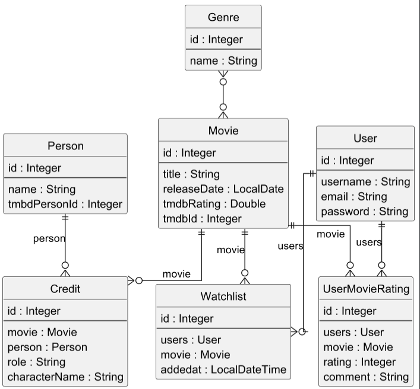

# Exam-Backend – Movie API

## Vision

Et Rest API til film, hvor brugere kan registrere sig, logge ind, give film en rating/kommentar og få anbefalinger ud fra hvilke film de har rated 7 eller over.

## Links

- Deployed application: https://exam.datudvikling.dk/api/healthcheck
- Source code repository: https://github.com/Britzgrank1/exam-backend
- Portfolio website: https://britzgrank1.github.io/Portfolio/
- Fuld API dokumentation: [docs/api-documentation.pdf](docs/api-documentation.pdf)

---

# Architecture

## System Overview

Backenden er bygget som en lagdelt arkitektur:

**Route → Controller → Service → DAO → Database**

- **Routes** (`Main.startServer`) – definerer endpoints og hvilken rolle der kræves
- **Controllers** – læser request (path params, body), kalder service og sender JSON/statuskode tilbage
- **Services** – forretningslogik (fx validering af rating 1-10 og anbefalingslogikken) og mapping til DTO'er
- **DAOs** – al databaseadgang via JPA/JPQL

Teknologier:

- Java 17
- Javalin 6
- JPA / Hibernate 7
- PostgreSQL 16
- Maven
- JWT (com.auth0 java-jwt) + bcrypt
- JUnit, Hamcrest, Testcontainers og Rest Assured
- Docker, GitHub Actions, Docker Hub, Watchtower og Caddy (deployment)
- SLF4J + Logback (til logging)

## Architecture Diagram

```
Client → Controller → Service → DAO → Database
```

Deployment flow:

```
git push → GitHub Actions (mvn clean package + tests) → Docker Hub → Watchtower → droplet
```

## Key Design Decisions

**Lagdeling**
Hvert lag har et ansvar. Controllers ved intet om databasen, og DAOs ved intet om HTTP. Det gør koden lettere at teste og ændre.

**Dependency injection af EntityManagerFactory**
DAOs får `EntityManagerFactory` gennem constructoren i stedet for at være singletons. Så kan testene give en test-EMF (Testcontainers) til de samme klasser. `Main.startServer(port, emf)` bruges både af `main` og af Rest Assured testene.

**DTO'er**
Entities bliver aldrig sendt direkte ud. Input og output går gennem DTO'er (fx `MovieRequestDTO`, `MovieResponseDTO`, `RateMovieDTO`, `RecommendationDTO`), så password-hash ikke lækker.

**Authentication**
Brugere registrerer sig og logger ind med username og password. Passwords bliver hashet med bcrypt. Ved login udstedes en JWT, som sendes med i headeren `Authorization: Bearer <token>`. Routes har en rolle (`ANYONE`, `USER`, `ADMIN`) og bliver tjekket i `beforeMatched` før controlleren køres. Mangler eller er tokenet ugyldigt giver det 401, forkert rolle giver 403.

**Error handling**
Alle fejl kastes som `ApiException(statuskode, besked)` og bliver fanget ét sted i `app.exception(...)`, som altid returnerer samme format: `{ "status": statusCode, "msg": "..." }`.

**Rating og anbefalinger**
En bruger kan kun have en rating per film (unique constraint på `user_id, movie_id`). Rater man igen bliver den eksisterende rating opdateret. Anbefalinger finder film i de genrer brugeren har givet 7 eller mere, som brugeren ikke selv har ratet endnu.

---

# Data Model

## ERD



Kilde: [`docs/erd.puml`](docs/erd.puml) (PlantUML).


## Important Entities

### Movie
En film hentet fra TMDB.
Felter: id, title, releaseDate, tmdbRating, tmdbId, genres (ManyToMany).

### Genre
En filmgenre.
Felter: id, name.

### User
En registreret bruger.
Felter: id, username (unik), email, password (gemt som bcrypt hash), roles (ManyToMany til Role).

### Role
En rolle brugeren kan have, fx `user` eller `admin`.
Felter: roleName.

### UserMovieRating
En brugers vurdering af en film.
Felter: id, user, movie, rating (1-10), comment.

---

# API Documentation

Den fulde API dokumentation med alle endpoints, request/response formater og fejlkoder ligger her: [docs/api-documentation.pdf](docs/api-documentation.pdf)

Base URL (lokalt): `http://localhost:7070`
Deployed: `https://exam.datudvikling.dk`

Beskyttede endpoints kræver headeren `Authorization: Bearer <token>`.

Alle fejl returneres i formatet:

```
{ "status": statusCode, "msg": "Explains the problem" }
```

## Example Endpoints

### Register User

**Endpoint:** `POST /api/auth/register`

**Request body:**
```json
{
  "username": "anna",
  "password": "secret123"
}
```

**Response:** `201 Created`
```json
{
  "username": "anna",
  "roles": ["user"]
}
```

Fejl: 400 hvis username eller password mangler, 409 hvis username allerede findes.

### Login

**Endpoint:** `POST /api/auth/login`

**Request body:**
```json
{
  "username": "anna",
  "password": "secret123"
}
```

**Response:** `200 OK`
```json
{
  "token": "eyJhbGciOi...",
  "username": "anna"
}
```

Fejl: 401 ved forkert username eller password.

### Rate a Movie (USER)

**Endpoint:** `POST /api/movies/{id}/rating`

**Request body:**
```json
{
  "rating": 9,
  "comment": "Fantastisk"
}
```

**Response:**
```json
{
  "id": 1,
  "movieId": 1,
  "movieTitle": "Inception",
  "username": "anna",
  "rating": 9,
  "comment": "Fantastisk"
}
```

Fejl: 400 hvis rating ikke er mellem 1-10, 401 uden gyldigt token, 404 hvis filmen ikke findes.

### Get Recommendations (USER)

**Endpoint:** `GET /api/recommendations`

**Response:** `200 OK`
```json
{
  "becauseYouLiked": ["Inception"],
  "recommendations": [
    {
      "id": 2,
      "title": "Interstellar",
      "releaseDate": "2014-11-05",
      "tmdbRating": 8.4,
      "genres": ["Science Fiction", "Drama"]
    }
  ]
}
```

Fejl: 401 uden gyldigt token.

---


# User Stories

- Som bruger vil jeg kunne registrere mig, så jeg har en konto.
- Som bruger vil jeg kunne logge ind og få et token, så jeg kan bruge de beskyttede endpoints.
- Som bruger vil jeg kunne give en film en rating fra 1-10 med en kommentar.
- Som bruger vil jeg få anbefalinger baseret på de film jeg har kunne lide ("because you liked X").
- Som admin vil jeg kunne oprette, opdatere og slette film.

---
